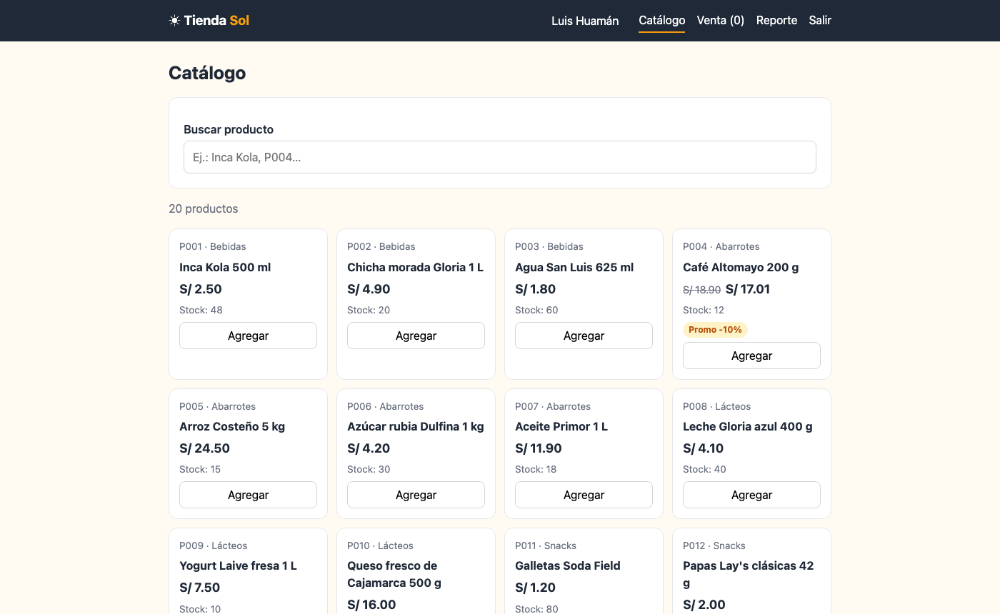
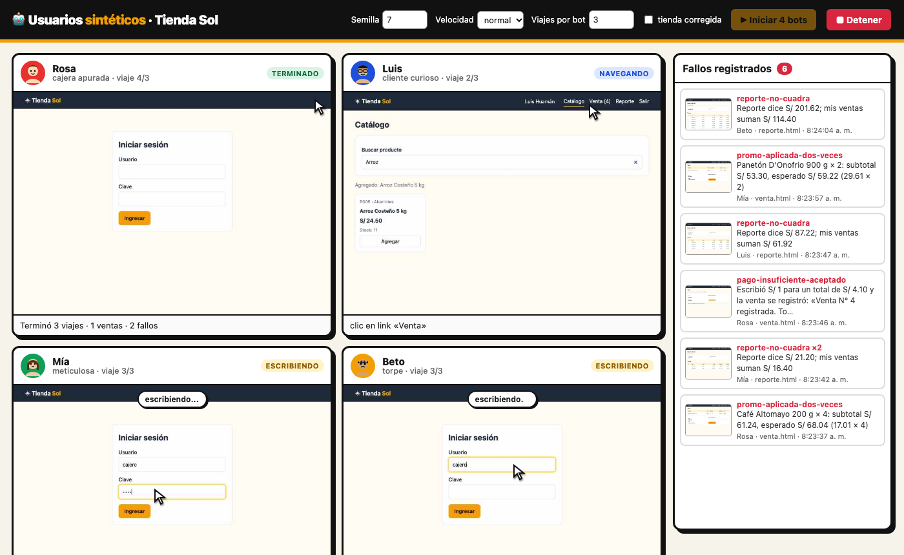
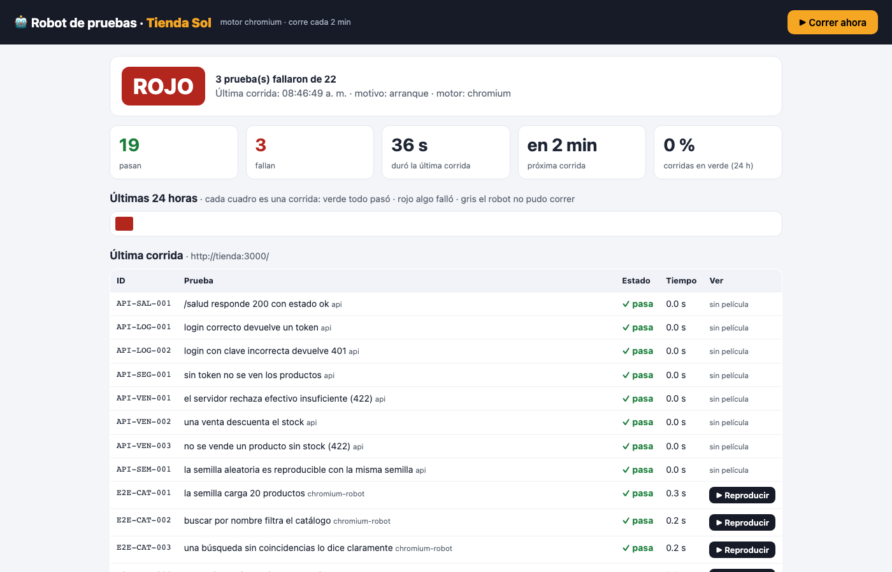
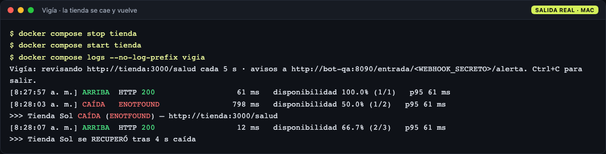
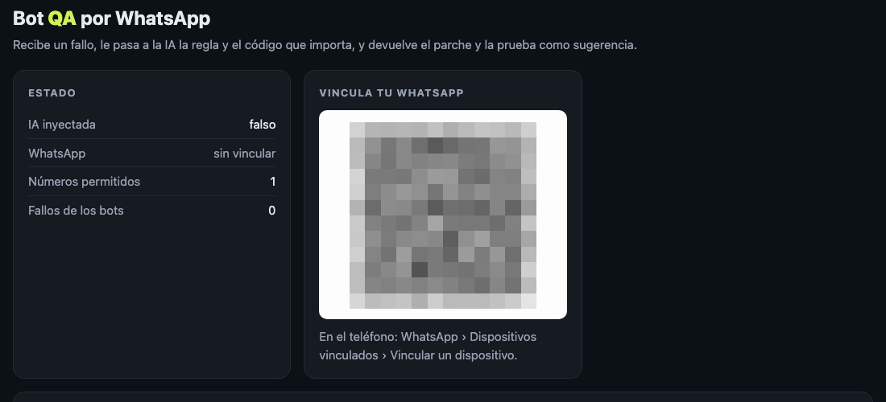
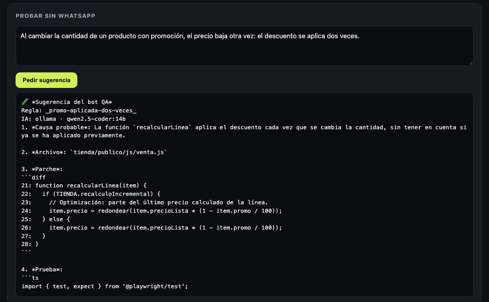
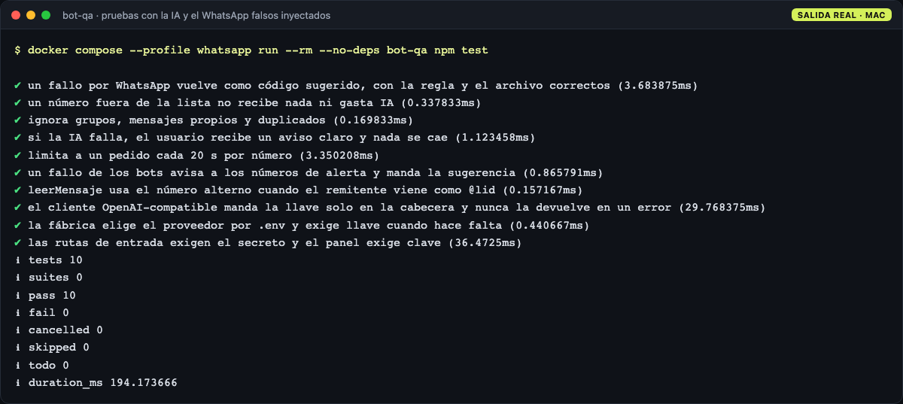

# QA Bots · ejemplos

Ejemplos del curso **«QA Bots: explora, vigila y repara con IA»** de JMD Learning, en modalidad web.

Al final del curso tienes tu propio **WhatsApp de QA**. Le escribes un fallo, o se lo manda un bot que lo
encontró solo, y te responde con el **código sugerido**: el archivo que hay que cambiar, el parche y la prueba
que lo demuestra. La IA que escribe ese código está **inyectada**: el bot recibe un cliente de IA y no sabe
cuál es. Puede ser DeepSeek, un modelo local con Ollama, otra API compatible con OpenAI o un cliente falso
para las pruebas.

Todo corre en Docker, así que los comandos son **los mismos en Windows y en Mac**.

| Parte | Qué levantas | Dónde lo ves |
|---|---|---|
| La app bajo prueba | Tienda Sol, con defectos a propósito | <http://127.0.0.1:3000> |
| 1 · Explora | 4 usuarios sintéticos (bots) que usan la tienda como personas | <http://127.0.0.1:3300> |
| 2 · Vigila | Un robot que corre las pruebas todo el día y un vigía que avisa si la tienda se cae | <http://127.0.0.1:3200> |
| 3 · Repara | La IA propone la corrección y tú abres el pull request | tu editor y GitHub |
| Proyecto final | Evolution Go (tu WhatsApp) y el bot QA con la IA inyectada | <http://127.0.0.1:8090> |

Los nombres, números y datos de la tienda son ficticios.

---

## 1. Prepara tu máquina

Solo necesitas **Docker Desktop** y, si quieres clonar, **Git**.

**Windows 10 u 11**

1. Abre PowerShell como administrador y ejecuta `wsl --install`. Reinicia la computadora.
2. Descarga Docker Desktop desde <https://docs.docker.com/desktop/setup/install/windows-install/> e instálalo
   con la opción «Use WSL 2» marcada.
3. Abre Docker Desktop y espera a que diga *Engine running*.

**Mac**

1. Descarga Docker Desktop para tu chip (Apple silicon o Intel) desde
   <https://docs.docker.com/desktop/setup/install/mac-install/>.
2. Arrastra Docker a Aplicaciones, ábrelo y espera a que diga *Engine running*.

Comprueba en una terminal (PowerShell en Windows, Terminal en Mac):

```bash
docker version
docker compose version
```

## 2. Descarga el repositorio y crea tu `.env`

```bash
git clone https://github.com/davrv93/qa-bots-ejemplos.git
cd qa-bots-ejemplos
```

Sin Git: en GitHub, botón **Code › Download ZIP**. Descomprímelo y entra a la carpeta con `cd`.

Copia el archivo de configuración:

```powershell
# Windows (PowerShell)
Copy-Item .env.example .env
```

```bash
# Mac (Terminal)
cp .env.example .env
```

Abre `.env` con tu editor y **cambia las cinco claves** del principio. Inventa cada una, con 16 caracteres o
más. En `NUMEROS_PERMITIDOS` pon tu número con el código de país, solo dígitos; para Perú es 51 seguido de tus
9 dígitos. `.env` no se sube a Git.

## 3. La app bajo prueba: Tienda Sol

```bash
docker compose up -d --build
```

Abre <http://127.0.0.1:3000> y entra con **cajero / cajero123**. Vende algo y mira el reporte. La tienda trae
defectos a propósito (`BUGS=1` en `.env`): los bots tienen que encontrarlos.



---

## Parte 1 · Explora: usuarios sintéticos

Cuatro bots con personalidad usan la tienda a la vez:

- Rosa, cajera apurada.
- Luis, cliente curioso.
- Mía, meticulosa.
- Beto, torpe.

Mueven el mouse en curvas, teclean letra por letra y se equivocan. Cada fallo queda registrado con su
evidencia: la captura, los pasos y las peticiones a la API, más una prueba de Playwright que lo reproduce.

```bash
docker compose --profile explora up -d --build
```

La primera vez descarga la imagen de Playwright con Chromium, que pesa cerca de 2 GB. Abre
<http://127.0.0.1:3300> y pulsa **Iniciar 4 bots**.



**Ojo con `reporte-no-cuadra` en local.** Aquí los cuatro bots comparten una sola tienda, y cada uno compara el
reporte del día con *sus* ventas. Por eso esa regla salta aunque la tienda esté bien: es un falso positivo del
oráculo. Lo comprobamos así: con la corrección de `venta.js` desaparecieron los fallos de promoción y de pago,
pero `reporte-no-cuadra` siguió saliendo. Arreglar el oráculo es un buen ejercicio; está en los prompts.

Con la misma semilla, los bots repiten los mismos recorridos. Así, un fallo que encuentran hoy lo vuelven a
encontrar mañana. Descarga la spec del fallo y cópiala a `pruebas/specs/`: es el pedido de corrección más claro
que puedes entregar.

## Parte 2 · Vigila: el robot y el vigía

```bash
docker compose --profile vigila up -d --build
```

- **El robot** (<http://127.0.0.1:3200>) corre las pruebas de `pruebas/` cada `CADA_MIN` minutos. Muestra el
  semáforo, la tira de las últimas 24 horas y la película paso a paso de cada prueba que falla.
- **El vigía** consulta `/salud` de la tienda cada 5 segundos. Avisa solo cuando el estado cambia: cuando la
  tienda se cae y cuando vuelve. Si el bot QA está levantado, el aviso llega a tu WhatsApp.



Para probar el vigía, apaga y prende la tienda:

```bash
docker compose stop tienda
docker compose start tienda
docker compose logs --no-log-prefix vigia
```



## Parte 3 · Repara: la IA propone, tú apruebas

Con la prueba en rojo y la evidencia del bot, le pides a tu asistente de código que arregle **la app**, no la
prueba. Después abres el pull request. Los prompts exactos están en [`prompts/README.md`](prompts/README.md)
(pasos 4 y 5).

Antes de aprobar el pull request, revisa tres cosas:

- Que la IA arregló la app y no relajó la prueba.
- Que el cambio es pequeño y se entiende.
- Que la descripción explica el fallo con su evidencia.

---

## Proyecto final · Tu WhatsApp de QA con la IA inyectada

```bash
docker compose --profile whatsapp up -d --build
```

Esto levanta tres piezas:

| Servicio | Qué hace |
|---|---|
| `postgres` | Guarda la sesión de WhatsApp de Evolution Go |
| `evolution-go` | La API de WhatsApp (Go, sobre whatsmeow) |
| `bot-qa` | Recibe los mensajes, le pide el código a la IA y responde |

La primera vez, `evolution-go` se compila desde su código fuente, así que tarda varios minutos.

### Vincula tu número

1. Abre <http://127.0.0.1:8090>. Usuario `admin` y, como contraseña, la `ADMIN_CLAVE` de tu `.env`.
2. En el teléfono: **WhatsApp › Dispositivos vinculados › Vincular un dispositivo**, y escanea el QR del panel.
3. Desde un número de `NUMEROS_PERMITIDOS`, escríbele al número vinculado: «ayuda».



*En la captura, el QR está pixelado a propósito. El tuyo se ve nítido y cambia cada 20 segundos.*

### Pídele código

Escríbele el fallo con tus palabras:

> Al cambiar la cantidad de un producto con promoción, el precio baja otra vez.

El bot hace esto:

1. Busca la regla de negocio en `bot-qa/conocimiento.json`.
2. Lee solo el trozo del archivo que la implementa.
3. Se lo pasa a la IA.
4. Te devuelve la causa, el archivo, el parche en `diff` y una prueba de Playwright.

**Es una sugerencia: nada se cambia solo.** Tú la revisas y la aplicas en una rama.

Si levantas también los bots (`--profile explora`), cada fallo nuevo que encuentran llega solo a tu WhatsApp,
con la sugerencia ya armada. Escribe «fallos» para ver la lista y «fallo 1» para pedir otra vez la sugerencia
del primero.



Esa respuesta es real: la dio `qwen2.5-coder:14b` en Ollama. Encontró la causa y el archivo correctos, pero en
vez de un `diff` devolvió la función entera ya corregida. En otra corrida, el mismo modelo propuso un parche que
quitaba el descuento por completo. Por eso el bot dice «sugerencia» y la última palabra la tienes tú: revisa,
corre la prueba y recién después abre el pull request.

Con el panel (**Probar sin WhatsApp**) puedes probar todo antes de vincular el teléfono.

### Cambia la IA sin tocar el código

En `.env`:

| `LLM_PROVEEDOR` | Qué usa | Llave |
|---|---|---|
| `falso` | Un cliente falso que responde siempre lo mismo. Sirve para probar todo sin gastar. | No |
| `deepseek` | DeepSeek, modelo `deepseek-flash` | `LLM_API_KEY` |
| `ollama` | Un modelo en tu máquina con Ollama (`qwen2.5-coder:14b` por defecto) | No |
| `openai`, `openrouter` | Esas APIs; pon también `LLM_MODELO` | `LLM_API_KEY` |
| cualquier otro | Toda API compatible con OpenAI: pon `LLM_BASE_URL` y `LLM_MODELO` | Si la pide |

Después de cambiarlo, recrea el bot:

```bash
docker compose --profile whatsapp up -d bot-qa
```

La llave vive solo en `.env` y en el contenedor `bot-qa`. Nunca llega al navegador, no se escribe en los
registros y, si la API devuelve un error, el bot no la repite.

Ojo con los registros de `evolution-go` y del `vigia`: muestran la URL del webhook, que incluye tu
`WEBHOOK_SECRETO`. Evolution Go también imprime el QR. No los pegues en un chat ni los muestres en un video.

### Así funciona la inyección

```text
servidor.js  (lee .env y arma las piezas reales)
   ├─ crearLLM()          → DeepSeek | Ollama | OpenAI | falso
   ├─ crearEvolution()    → Evolution Go            (o el WhatsApp falso)
   └─ crearConocimiento() → reglas → archivos
          │
          ▼
crearApp({ llm, whatsapp, conocimiento, … })   ← app.js no sabe cuál IA ni cuál WhatsApp recibe
```

Por eso las pruebas no necesitan llave, red ni teléfono: le inyectan un LLM falso y un WhatsApp falso.

```bash
docker compose --profile whatsapp run --rm --no-deps bot-qa npm test
```



### Sobre Evolution Go y el error 405

`evolution-go/Dockerfile` compila el fork público
[davrv93/evolution-go](https://github.com/davrv93/evolution-go) en un commit fijo, más un parche de una línea:
[`0001-version-del-handshake-405.patch`](evolution-go/0001-version-del-handshake-405.patch).

El parche existe por esto:

- WhatsApp rechaza con **`Client outdated (405)`** a los clientes que se presentan con una versión vieja.
- El síntoma es que el QR se queda en «Preparando el código QR…».
- El parche hace que el cliente salude con la versión vigente de WhatsApp Web, que consulta al arrancar, en vez
  de una versión fija que envejece.

Si algún día vuelve el 405, lo primero que hay que revisar es la versión, no la red.

---

## Problemas frecuentes

| Síntoma | Qué hacer |
|---|---|
| `required variable … is missing a value: Copia .env.example a .env` | Falta tu `.env` (paso 2). |
| `port is already allocated` | Ese puerto ya está ocupado: cambia el `PUERTO_…` en `.env`. |
| `all predefined address pools have been fully subnetted` | Docker se quedó sin redes libres. Borra las que no usas con `docker network prune` y vuelve a intentar. |
| El panel dice «Evolution Go no responde» | Revisa `docker compose logs evolution-go --tail 30`. La primera compilación tarda. |
| El QR se queda en «Preparando…» | Mira los registros de `evolution-go`: si aparece `405`, lee la sección del error 405. |
| El bot no contesta | ¿Tu número está en `NUMEROS_PERMITIDOS`, con el código de país y solo dígitos? El bot ignora a los demás y también los grupos. |
| «La IA no respondió ahora» | Revisa `LLM_PROVEEDOR` y `LLM_API_KEY`. Con `ollama`, comprueba que Ollama esté abierto y que tengas el modelo. |
| PowerShell: `curl` no funciona como en el video | En Windows PowerShell 5, `curl` es otro comando. Usa `curl.exe` o abre las URLs en el navegador. |

## Qué hay en el repositorio

```text
tienda/          Tienda Sol, la app bajo prueba (Node, sin dependencias)
pruebas/         Pruebas de Playwright con Page Objects
bots/            Los 4 usuarios sintéticos y su panel en vivo
robot/           El robot que corre la suite y guarda la película de cada prueba
vigia/           El vigía de disponibilidad (avisa solo cuando cambia el estado)
evolution-go/    Dockerfile y parche 405 de Evolution Go
postgres/        Base de datos de Evolution Go
bot-qa/          El bot QA: src/app.js (el núcleo), src/llm/ (las IA), src/whatsapp/, test/
prompts/         Los prompts de cada paso del curso
docs/            Casos de uso, mapa de la tienda y las capturas de este README
```

## Licencia

MIT. Evolution Go y whatsmeow conservan sus propias licencias: se descargan y compilan desde su fuente, no se
incluyen aquí. WhatsApp es una marca de Meta. Este repositorio es material educativo y no tiene relación con
Meta.
